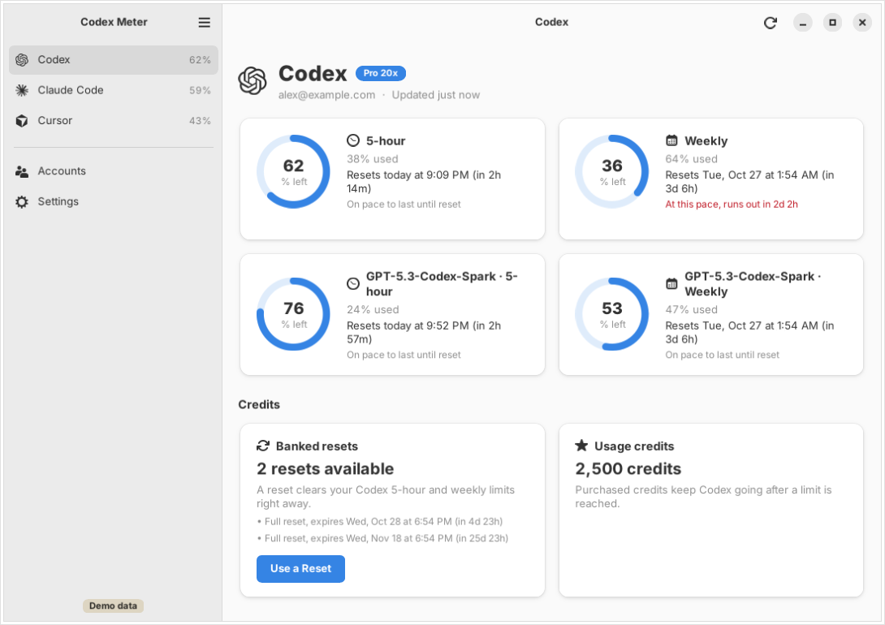

# Codex Meter for Linux

A native Linux desktop app built with **GTK 4 + libadwaita** (1.5 or later) in C#/.NET 10 through
[Gir.Core](https://gircore.github.io/). It follows the GNOME Human Interface Guidelines: an adaptive
split view that collapses to one pane on narrow windows, header bars, boxed lists, preferences pages,
toasts, alert dialogs, the system accent color, and light and dark styles. It also looks at home on
KDE Plasma, Cinnamon, Xfce and other desktops.



## What it does

- **A dashboard per service**: 24 services, the same list as the phone apps (Codex, Claude Code,
  Cursor, Copilot, Kimi, Z.ai, OpenRouter and others), each with its own page in the sidebar. Meters
  show 5-hour, weekly and monthly windows, per-model limits, included usage and spend, each with a
  ring, the reset time (countdown, date or both) and an optional pace estimate.
- **Usage history**: a chart of the current window against your typical path, with pace vs. typical,
  projected run-out, average window, peak burn rate and previous windows.
- **Edit dashboard**: hide cards and change their order, per service.
- **Codex reset credits**: see how many resets you have and when they expire, use one, or let the app
  use them automatically before they expire or when a limit runs low.
- **Accounts**: Add Account lists every service with search. Sign-in follows each service: browser
  login, a code to approve on the service's site, a token to paste back, or an API key.
- **Settings**: style, which services appear and their order, used vs. remaining, reset format,
  24-hour clock, pace, chart highlights, reset auto-use, refresh interval, reset and low-allowance
  notifications, tray icon, keep running when closed, start when you log in.
- **Tray icon** (StatusNotifierItem, so KDE, GNOME with the AppIndicator extension, Cinnamon, Xfce and
  others): shows your remaining percentage (turning amber, then red), a tooltip with every provider,
  and a menu to open, refresh or quit. Desktop notifications announce resets and low allowance.

Credentials are encrypted with AES-256-GCM. The key lives in your login keyring through the Secret
Service (GNOME Keyring, KWallet); if no keyring is available it falls back to a `0600` file. Data goes
in the XDG folders: `~/.local/share/codex-meter` (credentials), `~/.config/codex-meter` (settings) and
`~/.cache/codex-meter` (cached usage and the log). There is no relay server.

## Layout

| Path | What |
|------|------|
| `src/CodexMeter.Linux` | The GTK 4 + libadwaita app. It reuses `windows/src/CodexMeter.Core`, the cross-platform C# core (models, parsers, OAuth, provider clients, formatting, alerts), and the provider marks from the Windows app. |
| `tests/CodexMeter.Linux.Tests` | xUnit tests for the Linux layer: SVG path parsing, XDG paths and autostart, the tray icon. |
| `data/` | Desktop entry, AppStream metainfo and hicolor icons. |
| `packaging/` | Scripts that publish the app and build the `.deb` and AppImage. |
| `screenshots/` | Screenshots rendered by the app itself in demo mode. |

## Install

Each release has, for x86-64 and ARM64:

- `codex-meter_<version>_amd64.deb` / `_arm64.deb` for Debian 13, Ubuntu 24.04 and later, and their
  derivatives: `sudo apt install ./codex-meter_*.deb`.
- `CodexMeter-<version>-x86_64.AppImage` / `-aarch64.AppImage` for everything else. It bundles GTK and
  libadwaita: `chmod +x CodexMeter-*.AppImage && ./CodexMeter-*.AppImage`.

`SHA256SUMS-linux-*.txt` lists the checksums.

## Build and run

Needs the .NET 10 SDK plus GTK 4.12+, libadwaita 1.5+ and libsecret (Ubuntu 24.04:
`sudo apt install libadwaita-1-0 libgtk-4-1 libsecret-1-0`).

```sh
cd linux
dotnet test tests/CodexMeter.Linux.Tests
dotnet test ../windows/tests/CodexMeter.Core.Tests
dotnet run --project src/CodexMeter.Linux -- --demo
```

Command-line switches:

| Switch | Effect |
|--------|--------|
| `--demo` | Sample data for every provider, nothing saved, no network. |
| `--demo-signed-out` | Demo mode with no accounts connected. |
| `--page codex\|claude_code\|cursor\|accounts\|settings` | Open a page. |
| `--theme light\|dark` | Force a style. |
| `--minimized` | Start in the tray (used by the autostart entry). |
| `--screenshots DIR` | Render every page in light and dark, wide and narrow, into `DIR`, then exit. Works under `xvfb-run`. |

Packages:

```sh
linux/packaging/publish.sh x64         # self-contained build in linux/out/publish-x64
linux/packaging/build-deb.sh x64       # linux/out/codex-meter_<version>_amd64.deb
linux/packaging/build-appimage.sh x64  # linux/out/CodexMeter-<version>-x86_64.AppImage
```

The version comes from `versionName` in `android/app/build.gradle.kts`, or from the tag on tag builds.

## CI

`.github/workflows/linux-ci.yml` builds on x86-64 and ARM64 runners, runs the tests, validates the
desktop entry and metainfo, renders the screenshots, installs and launches the `.deb`, launches the
AppImage, and uploads everything as artifacts. On a `v*` tag it attaches the `.deb`, AppImage and
checksums to the GitHub release.

## Keeping in step with Windows

`Services/AppState.cs` is a copy of the Windows app's state class with only logging changed. When one
changes, change the other.
